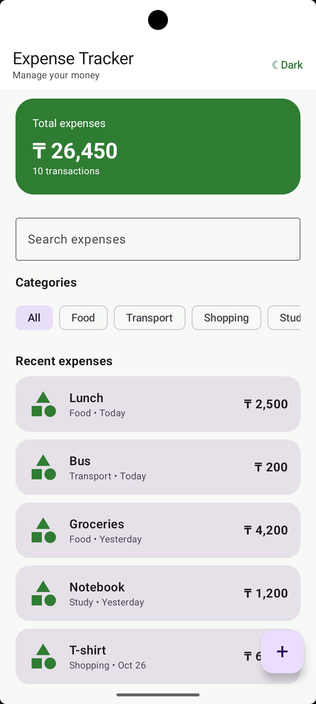
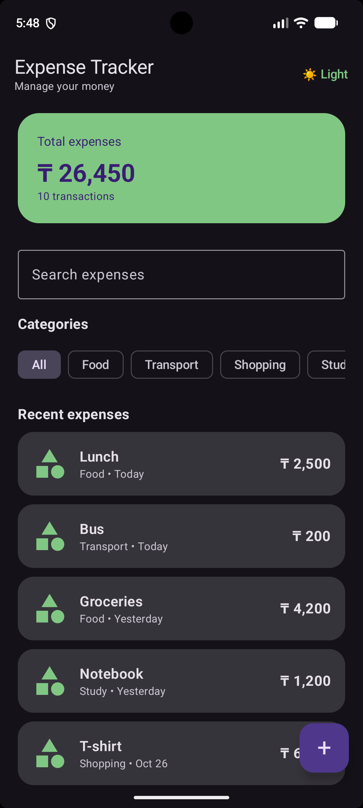

# Expense Tracker

## About the Project

Expense Tracker is an Android application for managing personal expenses. The application allows users to view, add, search, and filter expenses.

## Features

- View a list of expenses
- Add a new expense
- Search expenses by name
- Filter expenses by category
- View expense details
- Add or remove an expense from favorites
- Switch between light and dark themes

## Screens

The application has three main screens:

1. **Home Screen** — displays the total expenses, categories, search field, and a list of recent expenses.
2. **Expense Details Screen** — displays detailed information about a selected expense.
3. **Add Expense Screen** — allows the user to add a new expense.

## Technologies

- Kotlin
- Jetpack Compose
- Material 3
- Navigation Compose

## Project Structure

- `MainActivity.kt` — contains the main application logic, screens, navigation, and reusable components.
- `ui/theme/Color.kt` — contains custom colors for the application.
- `ui/theme/Theme.kt` — configures the light and dark themes.

## Screenshots

### Light Theme

### Dark Theme

